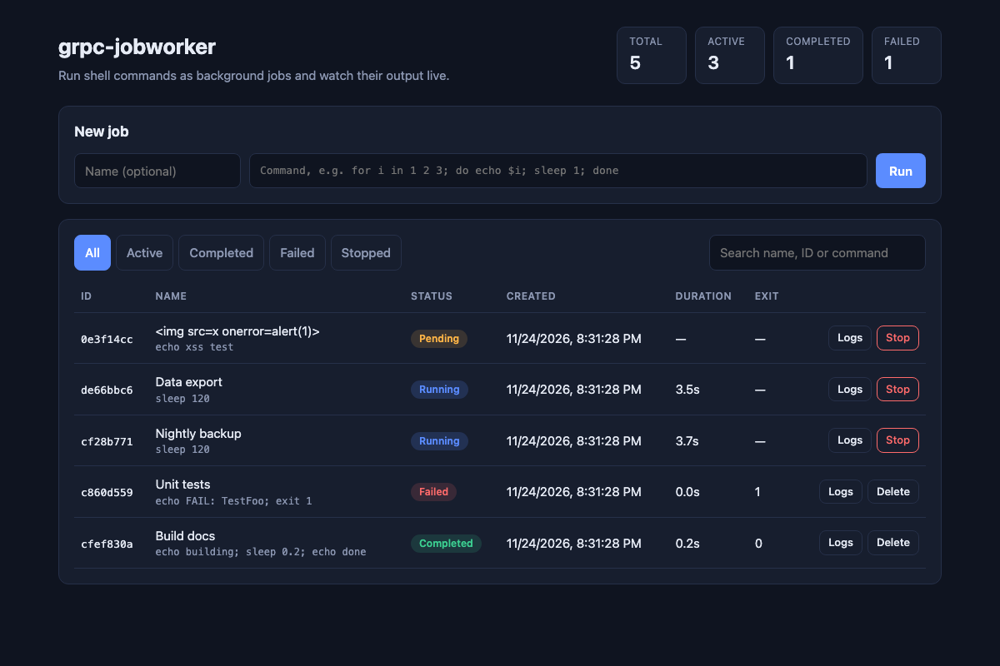
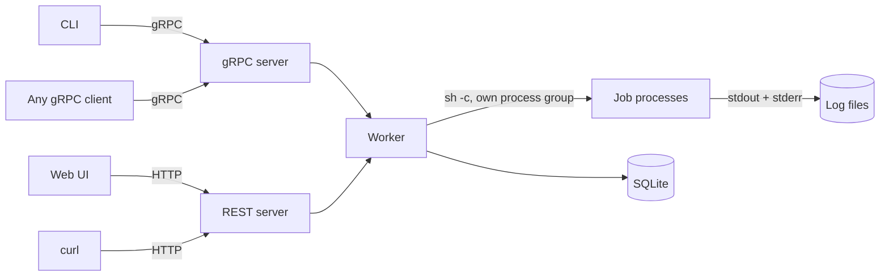
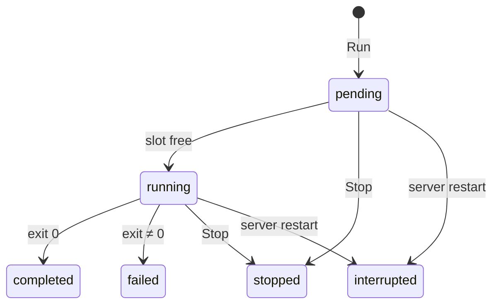

# grpc-jobworker

[](https://github.com/andrew-wzj/grpc-jobworker/actions/workflows/ci.yml)
[](LICENSE)

A small job runner written in Go. It runs shell commands as background jobs on a Linux or macOS host and exposes them through a **gRPC API**, a **REST API**, a **web UI** and a **CLI**.

- Run, stop, inspect, list and delete jobs
- Stream a job's output live over gRPC or HTTP
- Limit how many jobs run at once; extra jobs wait as `pending`
- Stop a job's whole process tree (process groups, SIGTERM then SIGKILL)
- Keep job history in SQLite; jobs cut off by a restart are marked `interrupted`
- Secure the gRPC API with TLS or mutual TLS, plus an optional bearer token



> I built this after graduating to practice Linux process management and gRPC in Go.

## Quick start

Requires Go 1.26 or later.

```bash
git clone https://github.com/andrew-wzj/grpc-jobworker.git
cd grpc-jobworker
make build                 # or: go build -o bin/jobworker ./cmd/jobworker
./bin/jobworker serve
```

The server starts:

- gRPC on `127.0.0.1:50051`
- HTTP (REST API and web UI) on <http://127.0.0.1:8080>

In another terminal:

```bash
./bin/jobworker run -name hello -follow -- 'for i in 1 2 3; do echo tick $i; sleep 1; done'
./bin/jobworker list
```

## Architecture



The gRPC and REST servers are thin layers over one `worker` package, so both behave the same way.

| Package | Responsibility |
|---|---|
| `internal/worker` | Starts jobs, enforces the concurrency limit, stops process groups, follows log output |
| `internal/store` | SQLite persistence (pure Go driver, no cgo) |
| `internal/grpcapi` | gRPC service, error-code mapping, token auth |
| `internal/httpapi` | REST endpoints and the embedded web UI |
| `internal/tlsconfig` | TLS and mutual-TLS configuration |
| `cmd/jobworker` | `serve` command and the gRPC client CLI |
| `proto/` → `gen/` | Protobuf API definition and generated code |

### Job lifecycle



## CLI

```text
jobworker serve                         start the gRPC and HTTP servers
jobworker run [-name N] [-follow] -- CMD...
jobworker list
jobworker get ID
jobworker logs ID                       stream output until the job finishes
jobworker stop ID
jobworker delete ID
```

`run -follow` streams the output and exits with the job's exit code, so it works in scripts.

Client flags: `-addr`, `-token`, `-tls-ca`, `-tls-cert`, `-tls-key`, `-tls-server-name`. `-addr` and `-token` default to `$JOBWORKER_ADDR` and `$JOBWORKER_TOKEN`.

### Server flags

| Flag | Default | Description |
|---|---|---|
| `-grpc-addr` | `127.0.0.1:50051` | gRPC listen address |
| `-http-addr` | `127.0.0.1:8080` | REST and web UI address (empty disables HTTP) |
| `-data-dir` | `data` | Holds `jobs.db` and `logs/` |
| `-max-concurrent` | `16` | Jobs allowed to run at once |
| `-token` | `$JOBWORKER_TOKEN` | Bearer token required on every API call |
| `-tls-cert`, `-tls-key` | | Enable TLS on gRPC |
| `-tls-client-ca` | | Require client certificates signed by this CA (mutual TLS) |

## gRPC API

Defined in [`proto/jobworker/v1/jobworker.proto`](proto/jobworker/v1/jobworker.proto):

| RPC | Description |
|---|---|
| `Run` | Submit a command; returns the job (pending or running) |
| `Stop` | Stop a pending or running job and its child processes |
| `Get` | Get one job |
| `List` | List all jobs, newest first |
| `Delete` | Delete a finished job and its log |
| `StreamOutput` | Server stream: output from the start, then live until the job ends |

Errors use standard gRPC codes: `NotFound`, `InvalidArgument`, `FailedPrecondition` (for example, deleting a running job) and `Unauthenticated`.

The server enables reflection, so you can explore it with [grpcurl](https://github.com/fullstorydev/grpcurl):

```bash
grpcurl -plaintext 127.0.0.1:50051 list
grpcurl -plaintext -d '{"cmd":"date"}' 127.0.0.1:50051 jobworker.v1.JobService/Run
```

## REST API

| Method | Path | Description |
|---|---|---|
| `POST` | `/api/jobs` | Body `{"name": "...", "cmd": "..."}`; returns `201` with the job |
| `GET` | `/api/jobs` | List jobs |
| `GET` | `/api/jobs/{id}` | Get one job |
| `POST` | `/api/jobs/{id}/stop` | Stop a job |
| `DELETE` | `/api/jobs/{id}` | Delete a finished job (`409` if it is still active) |
| `GET` | `/api/jobs/{id}/log` | Output so far; add `?follow=1` to stream until the job ends |
| `GET` | `/healthz` | Health check |

```bash
curl -X POST localhost:8080/api/jobs -d '{"name":"hello","cmd":"echo hello"}'
curl localhost:8080/api/jobs/<id>/log?follow=1
```

## Security

This service runs arbitrary shell commands as the user who started it. Treat API access as shell access.

- By default both servers listen on **localhost only**.
- The server **refuses to listen on a non-loopback address unless `-token` is set**.
- With a token, every gRPC and REST call needs `Authorization: Bearer <token>`. The web UI asks for it.
- For remote gRPC access, use TLS or mutual TLS. The REST server is plain HTTP; put it behind a TLS reverse proxy if it must be reachable remotely.

### Mutual TLS

```bash
make certs   # writes a dev CA and server/client certificates to certs/

./bin/jobworker serve -token "$JOBWORKER_TOKEN" \
  -tls-cert certs/server.crt -tls-key certs/server.key -tls-client-ca certs/ca.crt

./bin/jobworker list -token "$JOBWORKER_TOKEN" \
  -tls-ca certs/ca.crt -tls-cert certs/client.crt -tls-key certs/client.key
```

Clients without a certificate signed by the CA are rejected during the TLS handshake.

## Development

```bash
make test    # go test -race ./...
make lint    # go vet, gofmt, buf lint
make proto   # regenerate gen/ after editing the .proto file
```

The tests cover the worker (process-group stop, SIGKILL escalation, the concurrency limit with 120 jobs, live output, restart recovery), both APIs, token auth and mutual TLS.

## Limitations

- Jobs run as the server's user, with no CPU, memory or I/O isolation (no cgroups or namespaces).
- One server process; there is no distributed scheduling or clustering.
- Log files are kept until the job is deleted.

## License

[MIT](LICENSE)
